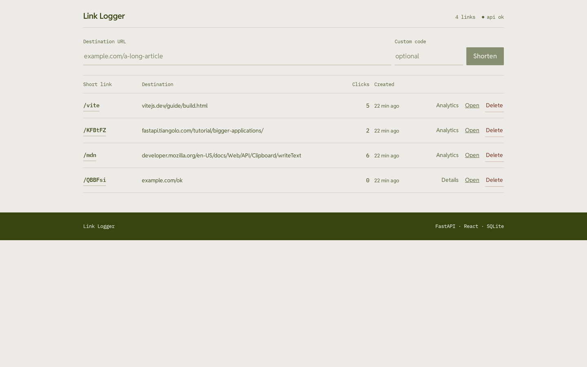
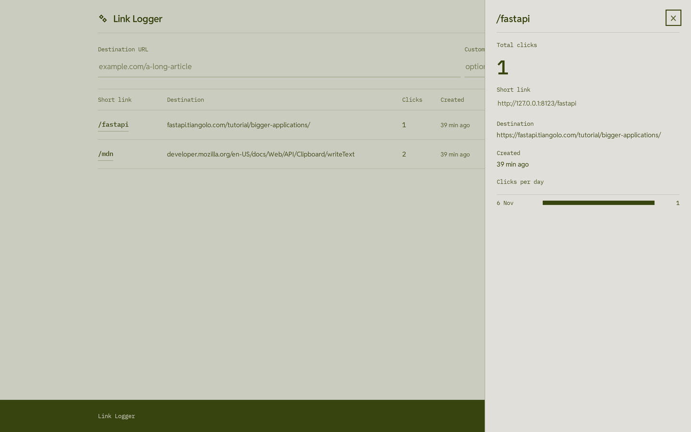
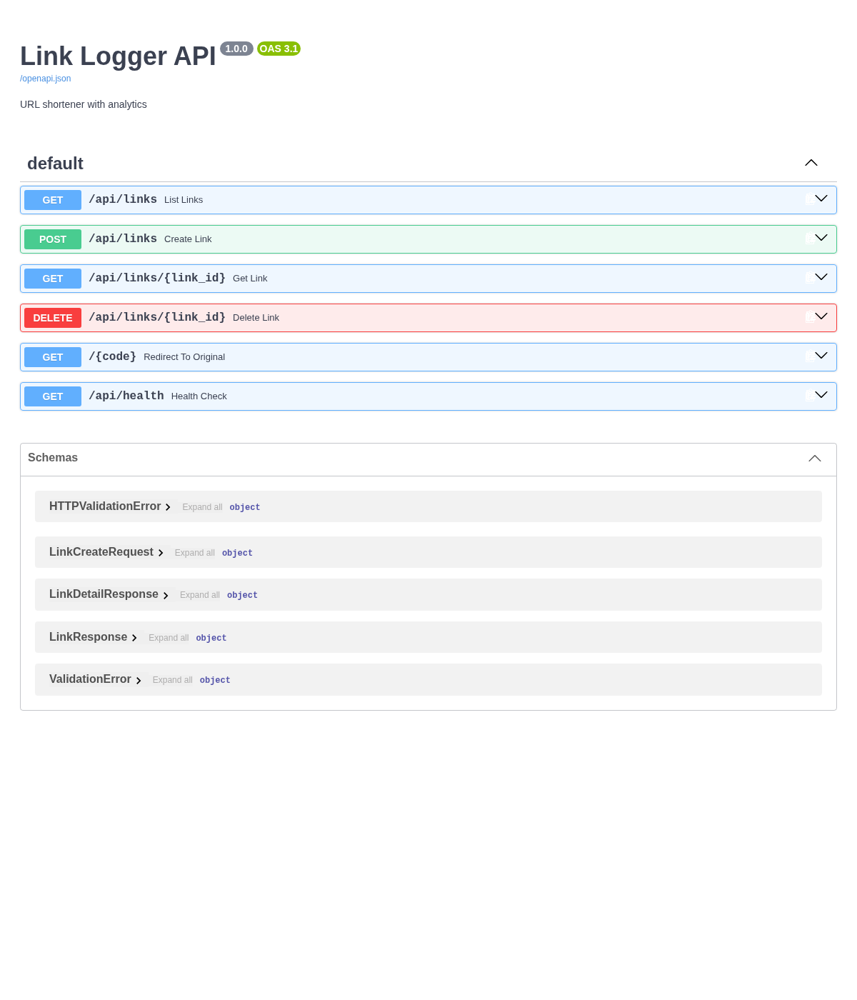

<p align="center"></p>

# Link Logger

A URL shortener with click analytics and honest retention — React (Vite) on the front, FastAPI and SQLite on the back.

**Live demo:** https://link-logger-pink.vercel.app/ · **CI:** 

## Screenshots

| Dashboard | Analytics | API docs (Swagger) |
|---|---|---|
|  |  |  |

## What it does

Create short, custom URLs and watch the clicks come in. Every visitor gets their own ten
slots, scoped to their browser — no account, no email, nothing to sign up for.

- Form to create short links (with optional custom code)
- **Ten live links per browser.** Creating an eleventh retires the oldest one, and the UI
  says which link it replaced instead of letting it vanish silently
- **30-day retention.** Every link carries an expiry; when it passes, the short code
  answers `410 Gone` with a small page instead of a dead redirect. Once the owner's next
  create purges the row, the code is simply unknown (`404`) and may be reused.
- Link list with destination, short URL, click count, creation date and time left
- **Click the short code to copy it** (with a clipboard fallback for non-secure contexts)
- Per-row actions: analytics, open the short link, delete with an inline confirm
- Click-through analytics in a side panel, with per-day bars
- Honest states: loading skeleton, empty state, and an error banner that never reports a
  failed request as "no links"
- Any URL scheme except `http`/`https` is rejected, so a short link can never redirect to
  `javascript:` or `data:`
- Responsive down to 390px, keyboard-reachable, `prefers-reduced-motion` respected
- Self-hosted type: Reddit Sans + IBM Plex Mono (OFL, licences in `public/fonts/`)

## Tech Stack

| Layer      | Technology                                    | Why                                                                 |
|------------|-----------------------------------------------|---------------------------------------------------------------------|
| Frontend   | React 18, Vite 6, vanilla CSS                 | Light setup, no UI framework overhead, full control over the UI     |
| Backend    | Python 3.11+, FastAPI, Pydantic               | Automatic OpenAPI docs; sync handlers keep the SQLite path simple   |
| Database   | SQLite file locally, Turso (libSQL) in production | Render's free filesystem is ephemeral; Turso keeps the rows alive |
| Deployment | Vercel (frontend), Render (backend), Turso (database) | Free tiers that stay free, and a database that survives a deploy |

## API

Full docs at `/docs` on the API host. Write and list calls need an `X-Owner-Token` header
(8–64 characters); the browser generates one and keeps it in `localStorage`.

| Method | Path              | Owner header | Description                                    |
|--------|-------------------|--------------|------------------------------------------------|
| POST   | `/api/links`      | required     | Create a short link; returns `evicted_code` when the cap was hit |
| GET    | `/api/links`      | required     | List this browser's live links                 |
| GET    | `/api/links/{id}` | required     | Link details + clicks per day                  |
| DELETE | `/api/links/{id}` | required     | Delete a link (404 if it is not yours)         |
| GET    | `/api/limits`     | —            | `{"links_per_owner": 10, "ttl_days": 30}`      |
| GET    | `/{code}`         | —            | `302` to the destination, `410` once expired   |
| GET    | `/api/health`     | —            | Status plus the storage backend in use         |

`POST /api/links` accepts only `http`/`https` destinations: any other scheme is rejected with
`422`, so a short link can never redirect to `javascript:` or `data:`.

Interactive API docs: [live API](https://link-logger-api.onrender.com/docs).

## Running Locally

Backend (Python 3.11+, no system packages needed beyond `uv`):

```bash
cd backend/fastapi
uv run --with fastapi==0.133.1 --with uvicorn==0.41.0 --with pydantic==2.13.4 \
  uvicorn main:app --port 8000
```

A `link_logger.db` SQLite file is created next to `main.py` on first run (gitignored, never
commit it). API at `http://localhost:8000`, docs at `http://localhost:8000/docs`.

Frontend:

```bash
cd frontend/react
npm install
npm run dev
```

Opens on `http://localhost:5173` against the local API. A production build reads
`VITE_API_URL`; when it is unset, `vite.config.js` falls back to the deployed API origin, so a
fork must set the variable to its own backend.

Tests:

```bash
cd backend/fastapi && pytest -q          # retention, ownership, storage wire format
bash test_backend.sh                     # end-to-end against a running API
```

## Deployment

**Database — Turso (free).** Render's free instances have an ephemeral filesystem, so a
SQLite file there is erased on every deploy or restart. The API therefore talks to Turso
over HTTPS when `TURSO_DATABASE_URL` is set, and to a local file when it is not.

1. Create a database at [turso.tech](https://turso.tech) (GitHub login, no card).
2. Copy its URL (`libsql://…`) and an auth token.
3. Set both on the Render service:

| Variable             | Value                                  |
|----------------------|----------------------------------------|
| `TURSO_DATABASE_URL` | `libsql://<db>-<org>.turso.io`         |
| `TURSO_AUTH_TOKEN`   | the token created in the Turso dashboard |
| `BASE_URL`           | `https://link-logger-api.onrender.com` |

**Frontend — Vercel.** Set `VITE_API_URL` to the Render API origin, or leave it unset only
if the frontend and API share an origin.

The free Render instance sleeps after a period of inactivity, so the first request after a
pause can take ~30 seconds. That is the host, not the database: links survive it, and the
UI shows the API as offline only while the request is actually failing.

## Design Choices

- **SQLite, portable to Turso** — the same SQL runs on a local file and on libSQL, so
  development and CI need no cloud credentials and production needs no Postgres driver.
  The storage layer is one small interface with two backends (`db.py`).
- **A bounded demo, stated plainly** — ten links and thirty days are product rules, not
  infrastructure limits. Both are enforced server-side (`MAX_LINKS_PER_OWNER`,
  `LINK_TTL_DAYS`), surfaced through `/api/limits`, and shown in the UI.
- **Ownership without accounts** — a random token in `localStorage` scopes each browser's
  list. It is not authentication and does not pretend to be; it stops one visitor's links
  from appearing in another's list, or being deleted by them.
- **Vanilla CSS, one stylesheet with design tokens** — no CSS framework and no inline
  styles. Every colour and face enters through a `:root` token, so the palette can be
  swapped in one place.
- **A drawn direction, not a default** — the palette ("olive on bone", one olive ink on a
  bone page, colour spent on the data) and the type pair came from a curated library rather
  than the usual blue-on-grey. Contrast is computed, not eyeballed: ink 8.69:1, muted
  5.02:1, the button 8.69:1 on the bone page.
- **One mark, every size** — the chain is drawn on a 32-unit grid with 2-unit walls and
  2-unit holes, so the same artwork survives 16 px instead of needing a second, simplified
  favicon. Verified: at 16 px it still rasterises as two separate links with two enclosed holes.
- **FastAPI** — automatic OpenAPI schema generation means the API docs write themselves
  from the code. Less boilerplate.
- **CORS configured** — the backend explicitly allows the Vercel origin and the two local
  dev origins, so the split deployment works without surprises.

## Author

FrozenProduction — full-stack developer (React + Java/Spring Boot) building portfolio
projects in Python and JavaScript.

## License

MIT
